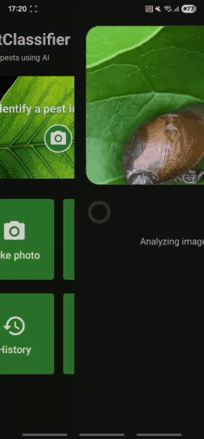

# 📱 PestClassifier - Aplicativo Android

O **PestClassifier** é uma aplicação nativa Android que realiza inferência de aprendizado profundo totalmente **offline** e em tempo real para a identificação e classificação de pragas de insetos na cultura da soja.

---

## 🎬 Demonstração em Vídeo

Demonstração do aplicativo executando a predição em tempo real diretamente no smartphone:

  
    
  <a href="https://youtube.com/shorts/91z50bZVgqI">▶️ <b>Assistir no YouTube Shorts</b></a> •
  <a href="assets/demo_pestclassifier.mp4">🎬 <b>Download do Vídeo Completo (.mp4)</b></a>

---

## 📥 Download do APK

Você pode baixar e instalar diretamente o binário compilado:

👉 **[Baixar PestClassifier-debug.apk (42 MB)](PestClassifier-debug.apk)**

---

## ⚙️ Características do Aplicativo

* **Modelo Embarcado:** EfficientNetV2-B1 otimizado para dispositivos móveis
* **Tecnologia:** TensorFlow Lite (TFLite com quantização FP16)
* **Operação:** Inferência em tempo real executada localmente no dispositivo (*On-device Edge AI*)
* **Conectividade:** **100% Offline** (funciona sem sinal de internet ou rede celular no campo)

---

## 🐛 Classes Identificadas (10 Pragas Econômicas da Soja)

| Índice | Nome Científico / Taxonômico | Nome Popular |
| :---: | :--- | :--- |
| **0** | *Anticarsia gemmatalis* | Lagarta-da-soja |
| **1** | Coccinellidae | Joaninha |
| **2** | *Diabrotica speciosa* | Vaquinha-verde-amarela |
| **3** | *Edessa meditabunda* | Percevejo-asa-verde |
| **4** | *Euschistus heros* | Percevejo-marrom-da-soja |
| **5** | Gastropoda | Lesmas e caracóis |
| **6** | *Lagria villosa* | Besouro-da-soja (Bicho-capixaba) |
| **7** | *Nezara viridula* | Percevejo-verde |
| **8** | *Rhachidosorus schistocercoides* | Gafanhoto-da-soja |
| **9** | *Spodoptera albula* | Lagarta-das-vagens |

---

## 📲 Como Instalar no Smartphone (Android)

1. Baixe o arquivo [`PestClassifier-debug.apk`](PestClassifier-debug.apk) no seu dispositivo móvel.
2. No Android, toque no arquivo baixado para iniciar a instalação.
3. Se solicitado, autorize a instalação a partir de **"Fontes Desconhecidas"** (*Instalar aplicativos desconhecidos*) nas configurações de segurança do aparelho.
4. Conceda as permissões de acesso à **Câmera** (para captura de imagens no campo) e ao **Armazenamento** (para selecionar fotos da galeria).
5. O aplicativo está pronto para uso direto no campo!
